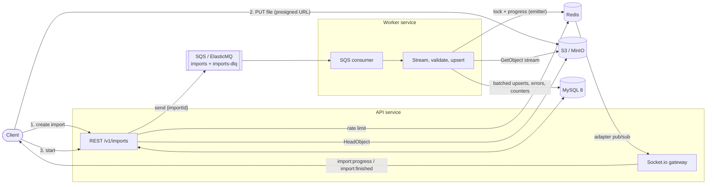
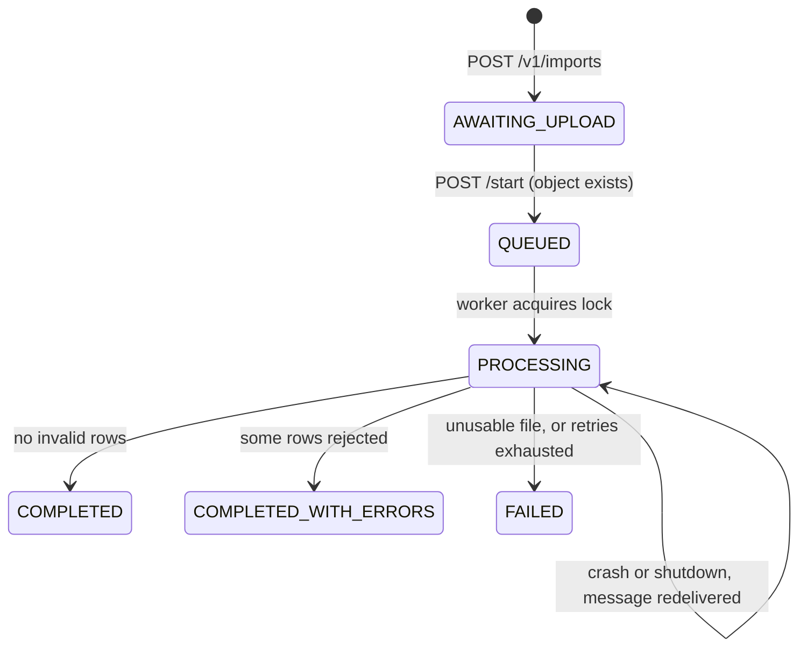
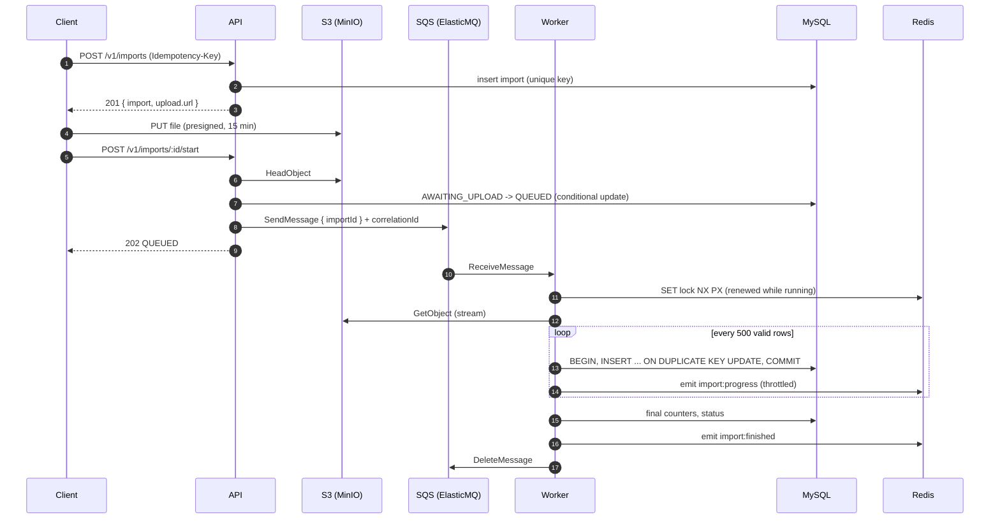

# bulk-import-pipeline

[](https://github.com/vinihellmann/bulk-import-pipeline/actions/workflows/ci.yml)

Asynchronous, streaming import of product catalogs (CSV or XLSX, 100k+ rows) into MySQL.
Clients upload files straight to object storage through presigned URLs, a queue decouples the
API from processing, and a separate worker streams the file row by row, validates it, upserts
in batches and pushes live progress over WebSockets.

Everything runs locally with `docker compose up` and costs nothing: MinIO stands in for S3 and
ElasticMQ for SQS. Both speak the AWS APIs, so the same code runs on AWS by changing
environment variables only.

**Stack:** Node 22, TypeScript (strict), Express 5, Sequelize 6 + MySQL 8.4, Redis 7 (ioredis),
AWS SDK v3 (S3, presigner, SQS), sqs-consumer, Socket.io 4 with the Redis adapter and emitter,
zod, winston, csv-parse, ExcelJS, umzug, Jest + SWC + supertest, oxlint + prettier.

## Contents

- [Architecture](#architecture)
- [Import lifecycle](#import-lifecycle)
- [Design decisions](#design-decisions)
- [Quick start](#quick-start)
- [Real-time progress](#real-time-progress)
- [API](#api)
- [Running the tests](#running-the-tests)
- [Local development without containers for the app](#local-development-without-containers-for-the-app)
- [Configuration](#configuration)
- [Project structure](#project-structure)
- [Trade-offs and next steps](#trade-offs-and-next-steps)

## Architecture



The file bytes never pass through the API. The API only signs URLs, validates state transitions
and enqueues jobs, so it stays small and horizontally scalable. The worker scales independently
by adding replicas; each replica handles one import at a time.

## Import lifecycle





## Design decisions

- **Presigned uploads instead of multipart through the API.** Large files would tie up API
  memory, sockets and bandwidth. Signing a PUT URL moves the transfer to the storage layer. The
  signer uses `S3_PUBLIC_ENDPOINT` (what the client can reach, `localhost:9000`) while the
  services use `S3_ENDPOINT` (`minio:9000`); on AWS both are unset.
- **Streaming end to end.** `GetObject` returns a stream that is piped into `csv-parse` or
  ExcelJS's `WorkbookReader` and consumed with `for await`. Backpressure is implicit: the S3
  socket is read only as fast as MySQL accepts batches. Memory is flat for any file size (for
  XLSX, the shared-strings table is the one structure kept in memory).
- **Two-level idempotency.** `POST /v1/imports` requires an `Idempotency-Key` backed by a
  unique index; a replay returns the original import and a mismatched payload returns 409.
  `POST /start` uses a conditional `UPDATE ... WHERE status = 'AWAITING_UPLOAD'` so only one
  caller enqueues, and rolls back if the enqueue fails.
- **At-least-once delivery made safe.** SQS can deliver a message twice. The worker takes a
  Redis lock (`SET NX PX`, compare-and-renew in Lua), skips finished imports, resets counters
  and stored errors when it (re)starts an import, and writes products with an upsert keyed on
  SKU, so replaying a file never duplicates rows.
- **One transaction per batch, not per file.** A file-wide transaction would hold locks for
  minutes and blow up the undo log. Batches of 500 rows are sorted by SKU (a stable lock order
  reduces deadlocks) and committed individually; replays are harmless because of the upsert.
- **Row errors are data, not exceptions.** Invalid rows are counted and stored in
  `import_errors` with row number, field and message. Storage is capped at 1000 per import to
  protect the database against a completely wrong file, while `failedRows` keeps the true count.
- **Retry and dead-letter policy.** Unexpected errors leave the message on the queue; the
  consumer shortens its visibility so the retry happens after `SQS_RETRY_DELAY_SECONDS`. The
  queue's redrive policy moves it to `imports-dlq` after 3 receives, and on that last receive
  (`ApproximateReceiveCount`) the worker marks the import `FAILED` so the client is not left
  waiting. Files that can never succeed (missing columns, corrupt workbook) fail immediately.
- **Visibility heartbeat and graceful shutdown.** While a message is in flight its visibility
  timeout is extended periodically, so a long import is never handed to a second worker. On
  `SIGTERM` the worker stops polling and lets the current import finish within a grace period;
  after that it aborts, and the message is redelivered.
- **Realtime that survives scaling.** The worker never runs a Socket.io server: it publishes
  through `@socket.io/redis-emitter`, and every API instance uses `@socket.io/redis-adapter`, so
  whichever instance holds the client's socket delivers the event. Progress is throttled (rows
  and time thresholds) so a fast import cannot flood Redis or the browser.
- **Rate limiting in Redis.** A fixed-window counter (`INCR` + `PEXPIRE` in one `MULTI`) shared
  by all instances, exposing `RateLimit-*` headers. It fails open: a cache outage should not take
  the API down with it.
- **Problem details everywhere.** Errors are `application/problem+json` (RFC 9457) with a
  request id; unexpected errors never leak SQL or stack traces.
- **Ports and adapters, lightly.** The domain (`modules/imports`) depends on small interfaces
  (`ObjectStorage`, `JobQueue`, `ImportRepository`, `ProgressPublisher`). Unit tests use
  in-memory fakes; integration tests use the real services.

## Quick start

Requirements: Docker with Compose v2, `curl` and `jq`.

```bash
docker compose up -d --build
curl -s localhost:3000/ready | jq
```

Import the sample catalog (15 rows, 3 of them invalid):

```bash
API=http://localhost:3000
KEY=local-dev-api-key-change-me

RESPONSE=$(curl -s -X POST "$API/v1/imports" \
  -H "x-api-key: $KEY" \
  -H "Idempotency-Key: $(date +%s%N)" \
  -H "Content-Type: application/json" \
  -d '{"fileName":"products-sample.csv","format":"csv"}')
IMPORT_ID=$(echo "$RESPONSE" | jq -r .import.id)
UPLOAD_URL=$(echo "$RESPONSE" | jq -r .upload.url)

# Upload straight to object storage (no API key involved, the URL is the credential).
curl -s -X PUT --upload-file fixtures/products-sample.csv "$UPLOAD_URL"

curl -s -X POST "$API/v1/imports/$IMPORT_ID/start" -H "x-api-key: $KEY" | jq
curl -s "$API/v1/imports/$IMPORT_ID" -H "x-api-key: $KEY" | jq
curl -s "$API/v1/imports/$IMPORT_ID/errors?limit=50" -H "x-api-key: $KEY" | jq
curl -s "$API/v1/imports/$IMPORT_ID/errors.csv" -H "x-api-key: $KEY"
```

Try a large file (generated inside the test image, written to `./fixtures`):

```bash
docker compose -f docker-compose.yml -f docker-compose.test.yml run --rm --no-deps \
  -v "$PWD/fixtures:/app/fixtures" test npm run generate:fixture -- --rows 200000
```

Then repeat the flow above with `fixtures/large-products.csv`.

| URL                                  | What                                  |
| ------------------------------------ | ------------------------------------- |
| http://localhost:3000/docs           | Interactive API reference (Scalar)    |
| http://localhost:3000/openapi.yaml   | OpenAPI 3.1 document                  |
| http://localhost:9001                | MinIO console (minioadmin/minioadmin) |

## Real-time progress

```js
import { io } from 'socket.io-client';

const socket = io('http://localhost:3000', { auth: { apiKey: 'local-dev-api-key-change-me' } });
await socket.emitWithAck('subscribe', { importId });
socket.on('import:progress', (p) => console.log(p.processedRows, p.failedRows));
socket.on('import:finished', (p) => console.log('done', p.status));
```

Payload: `{ importId, status, totalRows, processedRows, failedRows, errorMessage? }`.
`processedRows` only counts rows that are durably written (or rejected), never rows still in an
uncommitted batch.

## API

All `/v1` routes require `x-api-key`. Full contract in [`openapi.yaml`](openapi.yaml).

| Method | Path                           | Description                                          |
| ------ | ------------------------------ | ---------------------------------------------------- |
| POST   | `/v1/imports`                  | Create import, returns presigned PUT URL (15 min)    |
| POST   | `/v1/imports/:id/start`        | Verify upload, enqueue job (idempotent)              |
| GET    | `/v1/imports/:id`              | Status and counters                                  |
| GET    | `/v1/imports/:id/errors`       | Row errors, cursor pagination (`cursor`, `limit`)    |
| GET    | `/v1/imports/:id/errors.csv`   | Error report, streamed                               |
| GET    | `/health`, `/ready`            | Liveness and readiness (MySQL, Redis, S3)            |

Expected columns (header names are case-insensitive, extra columns are ignored):

| Column        | Rule                                        |
| ------------- | ------------------------------------------- |
| `sku`         | required, up to 64 chars, upsert key        |
| `name`        | required, up to 255 chars                   |
| `description` | optional                                    |
| `price`       | required, decimal > 0, up to 2 decimals     |
| `stock`       | required, integer >= 0                      |
| `category`    | required, up to 100 chars                   |

## Running the tests

```bash
# Unit tests (no services needed)
npm install
npm run test:unit

# Integration tests inside the compose network (MySQL, Redis, MinIO, ElasticMQ)
npm run test:docker
# equivalent to:
docker compose -f docker-compose.yml -f docker-compose.test.yml run --build --rm test
```

The integration suite boots a real API and a real worker in the test process and covers the
complete flow: idempotent creation, 409 before upload, presigned upload, Socket.io progress and
completion events, error pagination, CSV report, redelivery of a finished job, re-import upserts
by SKU, XLSX import and a file rejected for missing columns.

CI (GitHub Actions) runs lint, typecheck, build, unit tests and a formatting check on Node 22,
and the integration suite through Docker Compose.

## Local development without containers for the app

```bash
cp .env.example .env
docker compose up -d mysql redis minio minio-init elasticmq
npm install
npm run migrate
npm run dev          # API with tsx watch
npm run dev:worker   # worker with tsx watch
```

## Configuration

Every variable is validated with zod at startup; the process refuses to boot with an invalid
configuration. See [`.env.example`](.env.example) for the documented list. Running on AWS:

| Variable                | Local                    | AWS                          |
| ----------------------- | ------------------------ | ---------------------------- |
| `S3_ENDPOINT`           | `http://minio:9000`      | unset                        |
| `S3_PUBLIC_ENDPOINT`    | `http://localhost:9000`  | unset                        |
| `S3_FORCE_PATH_STYLE`   | `true`                   | `false`                      |
| `SQS_ENDPOINT`          | `http://elasticmq:9324`  | unset                        |
| `SQS_QUEUE_URL`         | ElasticMQ URL            | real queue URL               |
| `AWS_ACCESS_KEY_ID` ... | `minioadmin`             | unset (IAM role)             |

MinIO no longer publishes official container images, so Compose uses `pgsty/minio` and
`pgsty/mc`, community builds of the same open source code, pinned to a release tag.

## Project structure

```text
src/
  server.ts               API entrypoint (HTTP + Socket.io)
  worker.ts               worker entrypoint (SQS consumer)
  api.ts                  API composition (used by server and tests)
  workerRuntime.ts        consumer, heartbeat, graceful stop
  config/env.ts           zod-validated configuration
  http/
    app.ts                Express app: helmet, CORS, auth, rate limit, routes, errors
    middleware/           requestContext, apiKey, rateLimit, errorHandler
    routes/               imports, health
  infra/
    container.ts          shared infrastructure + readiness checks
    db/                   Sequelize, models, umzug migrations
    s3.ts sqs.ts redis.ts lock.ts realtime.ts logger.ts
  modules/imports/
    importService.ts      create/start/query use cases (API side)
    importProcessor.ts    streaming pipeline (worker side)
    jobHandler.ts         SQS message -> processor, retry/FAILED policy
    parsers/              CSV and XLSX streaming parsers
    rowValidator.ts batchWriter.ts progressThrottle.ts repository.ts csvExport.ts
__tests__/
  unit/                   fakes + unit tests
  integration/            harness + end-to-end tests against real services
infra/elasticmq.conf      queue + DLQ redrive policy
scripts/generate-fixture.ts
openapi.yaml
```

## Trade-offs and next steps

- **No resumable checkpoints.** A redelivered import restarts from row 1. Upserts make that
  correct, but a 10M row file would redo work. Next step: persist the last committed row
  number per import and skip ahead on resume.
- **XLSX shared strings in memory.** Streaming XLSX still needs the shared-strings table. For
  very large workbooks with mostly unique strings, recommend CSV or convert upstream.
- **One import per worker process.** Simple to reason about and scale with replicas; a
  `batchSize > 1` consumer with per-import concurrency limits would use CPU better.
- **API key auth.** Fine for service-to-service use; multi-tenant use would need per-tenant
  keys or OAuth client credentials, and tenant scoping on every query.
- **Fixed-window rate limiting** allows short bursts at window edges; a sliding window or token
  bucket (Lua) would be smoother.
- **Observability.** Logs are structured JSON with correlation ids that flow from the HTTP
  request to the SQS message. Next: OpenTelemetry traces across API, queue and worker, plus
  metrics (rows/s, batch latency, DLQ depth) and an alarm on the DLQ.
- **Upload validation.** The presigned URL does not restrict size or content type; a POST
  policy with `content-length-range` would.

## License

[MIT](LICENSE)
