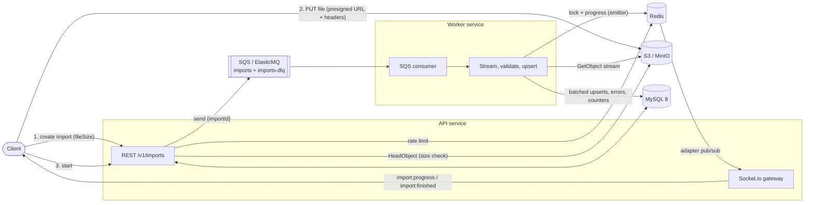
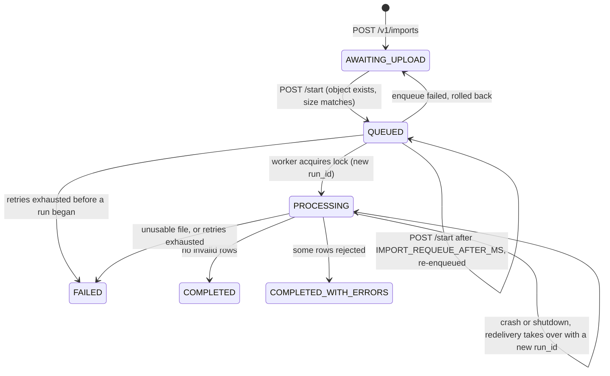
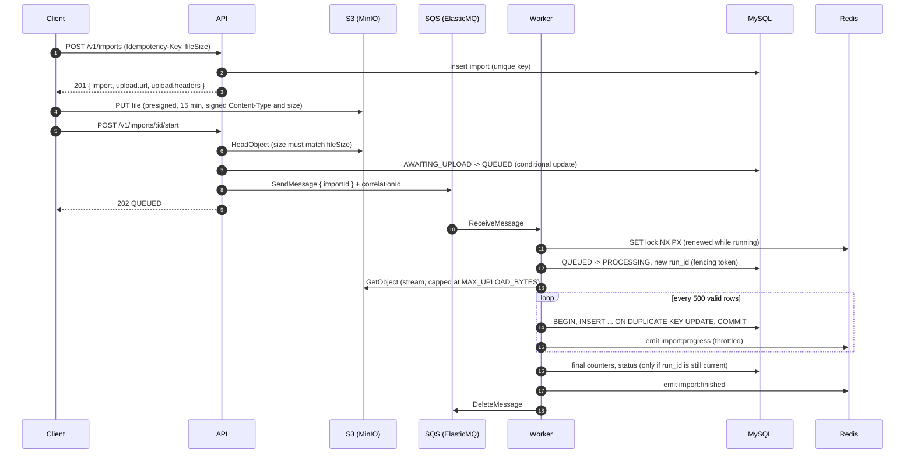

# bulk-import-pipeline

[](https://github.com/vinihellmann/bulk-import-pipeline/actions/workflows/ci.yml)

Asynchronous, streaming import of product catalogs (CSV or XLSX, 100k+ rows) into MySQL.
Clients upload files straight to object storage through presigned URLs, a queue decouples the
API from processing, and a separate worker streams the file row by row, validates it, upserts
in batches and pushes live progress over WebSockets.

Everything runs locally with `docker compose up` and costs nothing: MinIO stands in for S3 and
ElasticMQ for SQS. Both speak the AWS APIs, so the same code runs on AWS by changing
environment variables only.

**Stack:** Node 22, TypeScript (strict), Express 5, Sequelize 6 + MySQL 8.4, Redis 7 (ioredis),
AWS SDK v3 (S3, presigner, SQS), sqs-consumer, Socket.io 4 with the Redis adapter and emitter,
zod, winston, csv-parse, ExcelJS, umzug, Jest + SWC + supertest, oxlint + prettier.


_Recorded with [`scripts/demo.sh`](scripts/demo.sh) against `docker compose up`._

## Contents

- [Architecture](#architecture)
- [Import lifecycle](#import-lifecycle)
- [Design decisions](#design-decisions)
- [Security](#security)
- [Quick start](#quick-start)
- [Real-time progress](#real-time-progress)
- [API](#api)
- [Running the tests](#running-the-tests)
- [Local development without containers for the app](#local-development-without-containers-for-the-app)
- [Configuration](#configuration)
- [Project structure](#project-structure)
- [Upgrading](#upgrading)
- [Trade-offs and next steps](#trade-offs-and-next-steps)

## Architecture



The file bytes never pass through the API. The API only signs URLs, validates state transitions
and enqueues jobs, so it stays small and horizontally scalable. The worker scales independently
by adding replicas; each replica handles one import at a time.

## Import lifecycle



The transition table lives in one place (`domain/status.ts`). The service and processor reason
with it, and the repository derives every conditional `UPDATE ... WHERE status IN (...)` from
it, so the database enforces exactly the same machine. `COMPLETED`, `COMPLETED_WITH_ERRORS` and
`FAILED` are terminal.



## Design decisions

- **Presigned uploads instead of multipart through the API.** Large files would tie up API
  memory, sockets and bandwidth. Signing a PUT URL moves the transfer to the storage layer. The
  client declares `fileSize` up front and the URL is signed for exactly that `Content-Length`
  and the format's `Content-Type`, so storage itself refuses anything else. The signer uses `S3_PUBLIC_ENDPOINT` (what the client can reach, `localhost:9000`) while the
  services use `S3_ENDPOINT` (`minio:9000`); on AWS both are unset.
- **Streaming end to end.** `GetObject` returns a stream that is piped into `csv-parse` or
  ExcelJS's `WorkbookReader` and consumed with `for await`. Backpressure is implicit: the S3
  socket is read only as fast as MySQL accepts batches. Memory is flat for any file size (for
  XLSX, the shared-strings table is the one structure kept in memory).
- **Two-level idempotency.** `POST /v1/imports` requires an `Idempotency-Key` backed by a
  unique index per client (`client_id`, `idempotency_key`); a replay returns the original import
  and a mismatched payload (name, format or size) returns 409.
  `POST /start` uses a conditional `UPDATE ... WHERE status = 'AWAITING_UPLOAD'` so only one
  caller enqueues, and rolls back if the enqueue fails.
- **At-least-once delivery made safe.** SQS can deliver a message twice. The worker takes a
  Redis lock (`SET NX PX`, compare-and-renew in Lua), skips finished imports, resets counters
  and stored errors when it (re)starts an import, and writes products with an upsert keyed on
  SKU, so replaying a file never duplicates rows.
- **Fencing token for every run.** A lock can expire under a paused or partitioned worker while
  another one takes over. Each `QUEUED -> PROCESSING` transition generates a `run_id`; counters,
  errors and the final status are written only `WHERE run_id = <mine> AND status = 'PROCESSING'`.
  A worker that lost its lock gets a `StaleRunError` instead of overwriting the new run, and the
  message is simply redelivered. Product upserts are not fenced: they are idempotent by design.
- **Lost enqueue recovery.** If the API dies between `AWAITING_UPLOAD -> QUEUED` and the SQS
  send, the import would sit in `QUEUED` forever. A repeated `POST /start` on an import that has
  been `QUEUED` for longer than `IMPORT_REQUEUE_AFTER_MS` re-enqueues it; a conditional touch
  lets exactly one caller win, and a duplicate message is harmless (lock and status checks).
- **One transaction per batch, not per file.** A file-wide transaction would hold locks for
  minutes and blow up the undo log. Batches of 500 rows are sorted by SKU (a stable lock order
  reduces deadlocks) and committed individually; replays are harmless because of the upsert.
- **Row errors are data, not exceptions.** Invalid rows are counted and stored in
  `import_errors` with row number, field and message. Storage is capped at 1000 per import to
  protect the database against a completely wrong file, while `failedRows` keeps the true count.
- **Retry and dead-letter policy.** Unexpected errors leave the message on the queue; the
  consumer shortens its visibility so the retry happens after `SQS_RETRY_DELAY_SECONDS`. The
  queue's redrive policy moves it to `imports-dlq` after 3 receives, and on that last receive
  (`ApproximateReceiveCount`) the worker marks the import `FAILED` so the client is not left
  waiting. Files that can never succeed (missing columns, corrupt workbook, over the row limit)
  fail immediately. A run that ends with a lost lock, a stale run or a shutdown is never marked
  `FAILED`, because someone else owns the import now.
- **Visibility heartbeat and graceful shutdown.** While a message is in flight its visibility
  timeout is extended periodically, so a long import is never handed to a second worker. On
  `SIGTERM` the worker stops polling and lets the current import finish within a grace period;
  after that it aborts, and the message is redelivered.
- **Realtime that survives scaling.** The worker never runs a Socket.io server: it publishes
  through `@socket.io/redis-emitter`, and every API instance uses `@socket.io/redis-adapter`, so
  whichever instance holds the client's socket delivers the event. Progress is throttled (rows
  and time thresholds) so a fast import cannot flood Redis or the browser.
- **Rate limiting in Redis.** An approximate sliding window (current window count plus the
  previous one weighted by how much of it still overlaps) computed in a single atomic Lua `EVAL`,
  shared by all instances, exposing `RateLimit-*` headers. It runs twice: per source IP before
  authentication (`RATE_LIMIT_IP_MAX`, throttles key guessing) and per client after it
  (`RATE_LIMIT_MAX`). It fails open: a cache outage should not take the API down with it.
- **Problem details everywhere.** Errors are `application/problem+json` (RFC 9457) with a
  request id; unexpected errors never leak SQL or stack traces.
- **Ports and adapters, lightly.** The module (`modules/imports`) is layered: `domain` (types,
  state machine, ports, errors, row validation), `application` (service, processor, job handler)
  and `infrastructure` (Sequelize, parsers, CSV export), with `http` as the delivery adapter.
  Dependencies point inward through small interfaces (`ObjectStorage`, `JobQueue`,
  `ImportRepository`, `ProgressPublisher`). Unit tests use in-memory fakes; integration tests use
  the real services. Two pragmatic exceptions are marked in code: the service uses the CSV line
  formatter and the processor uses the streaming parsers directly.

## Security

- **API keys are hashed and bound to a client.** `API_KEYS` holds `clientId:sha256hex` entries,
  so a leaked environment or config dump does not reveal usable keys. Keys are random 32-byte
  secrets, which is why a fast hash is enough (a slow password hash would only add CPU cost to
  every request). Comparison is constant time with no early exit. Several entries per client
  allow rotation: add the new hash, migrate callers, drop the old one. Generate a pair with
  `npm run generate:api-key -- <clientId>`.
- **Tenant isolation.** Every import belongs to the client that created it. Reading, starting
  or listing another client's import returns 404, the same as a missing one, so ids cannot be
  probed. `Idempotency-Key` is unique per client, and S3 keys are prefixed with the client id.
  WebSocket subscriptions are authorized against the import's owner and capped per socket
  (`SOCKET_MAX_SUBSCRIPTIONS`).
- **Upload limits at three layers.** The declared `fileSize` is capped by `MAX_UPLOAD_BYTES`
  and signed into the presigned URL together with `Content-Type`; `start` compares the stored
  object's size with the declaration; and the worker enforces the cap again on the byte stream,
  plus `IMPORT_MAX_ROWS` and a 1 MiB CSV record limit. Each layer assumes the previous one can
  be bypassed.
- **Encryption in transit.** MySQL TLS (`DB_SSL`, `DB_SSL_CA`, certificate verification on by
  default) and Redis TLS (`rediss://`, `REDIS_TLS_CA`). In production the config refuses a
  wildcard CORS origin, a missing `DB_PASSWORD` and the legacy plaintext `API_KEY`, and logs a
  warning when MySQL or Redis are not using TLS or certificate verification is off.
- **Encryption at rest.** Set `S3_SSE=AES256` or `aws:kms` (+ `S3_KMS_KEY_ID`) and the SSE headers
  are signed into the upload URL; the client must send them from `upload.headers`, so the
  uploader cannot opt out.
- **Rate limiting.** Per IP before auth and per client after it (see above). Set `TRUST_PROXY`
  behind a load balancer, otherwise every client shares the balancer's IP.
- **Error hygiene.** Problem details never include SQL or stack traces, and a `FAILED` import
  after exhausted retries stores a generic message (`Processing failed after N attempts`)
  instead of the internal error text; the full error stays in the logs. Only file problems
  (missing column, row limit) are reported verbatim, since they help the client fix its file.
- **Container and supply chain.** One pinned base image (`NODE_IMAGE` build arg), `tini` as PID 1,
  app files root-owned and read-only for the unprivileged `node` user, an API `HEALTHCHECK`,
  `npm ci` only (lockfile-exact) and production dependencies installed with `--ignore-scripts`.
  CI runs `npm audit` and a Trivy scan of the runtime image (CRITICAL/HIGH, fixable only), and
  Dependabot updates npm, Docker and GitHub Actions weekly.

## Quick start

Requirements: Docker with Compose v2, `curl` and `jq`.

```bash
docker compose up -d --build
curl -s localhost:3000/ready | jq
```

Run the whole walkthrough at once (sample file, then a generated 100k-row file):

```bash
./scripts/demo.sh                # DEMO_ROWS=200000 DEMO_PAUSE=0 to tweak
```

Or step by step. Import the sample catalog (15 rows, 3 of them invalid):

```bash
API=http://localhost:3000
KEY=local-dev-api-key-change-me

FILE=fixtures/products-sample.csv
SIZE=$(wc -c < "$FILE")

# fileSize is required: it is signed into the upload URL.
RESPONSE=$(curl -s -X POST "$API/v1/imports" \
  -H "x-api-key: $KEY" \
  -H "Idempotency-Key: $(date +%s%N)" \
  -H "Content-Type: application/json" \
  -d "{\"fileName\":\"products-sample.csv\",\"format\":\"csv\",\"fileSize\":$SIZE}")
IMPORT_ID=$(echo "$RESPONSE" | jq -r .import.id)
UPLOAD_URL=$(echo "$RESPONSE" | jq -r .upload.url)

# Upload straight to object storage (no API key involved, the URL is the credential).
# Send the headers listed in upload.headers (Content-Type here, plus the x-amz-server-side-
# encryption-* headers when S3_SSE is set) and a body of exactly fileSize bytes.
echo "$RESPONSE" | jq .upload.headers
curl -s -X PUT --upload-file "$FILE" -H "Content-Type: text/csv" "$UPLOAD_URL"

curl -s -X POST "$API/v1/imports/$IMPORT_ID/start" -H "x-api-key: $KEY" | jq
curl -s "$API/v1/imports/$IMPORT_ID" -H "x-api-key: $KEY" | jq
curl -s "$API/v1/imports/$IMPORT_ID/errors?limit=50" -H "x-api-key: $KEY" | jq
curl -s "$API/v1/imports/$IMPORT_ID/errors.csv" -H "x-api-key: $KEY"
```

The compose file configures the SHA-256 hash of `local-dev-api-key-change-me` as client
`default` (`API_KEYS`), so the key above works out of the box. Uploads are limited to 50 MiB by
default (`MAX_UPLOAD_BYTES`).

Try a large file (generated inside the test image, written to `./fixtures`):

```bash
docker compose -f docker-compose.yml -f docker-compose.test.yml run --rm --no-deps \
  -v "$PWD/fixtures:/app/fixtures" test npm run generate:fixture -- --rows 200000
```

Then repeat the flow above with `FILE=fixtures/large-products.csv` (and its name in `fileName`).

| URL                                | What                                  |
| ---------------------------------- | ------------------------------------- |
| http://localhost:3000/docs         | Interactive API reference (Scalar)    |
| http://localhost:3000/openapi.yaml | OpenAPI 3.1 document                  |
| http://localhost:9001              | MinIO console (minioadmin/minioadmin) |

## Real-time progress

```js
import { io } from 'socket.io-client';

const socket = io('http://localhost:3000', { auth: { apiKey: 'local-dev-api-key-change-me' } });
const ack = await socket.emitWithAck('subscribe', { importId });
if (!ack.ok) throw new Error(ack.error); // 'not found' for unknown or foreign imports
socket.on('import:progress', (p) => console.log(p.processedRows, p.failedRows));
socket.on('import:finished', (p) => console.log('done', p.status));
```

The key is checked on connect and each subscription is authorized against the import's owner:
a client can only watch its own imports, and a socket holds at most `SOCKET_MAX_SUBSCRIPTIONS`
(20) of them. Payload: `{ importId, status, totalRows, processedRows, failedRows, errorMessage? }`.
`processedRows` only counts rows that are durably written (or rejected), never rows still in an
uncommitted batch.

## API

All `/v1` routes require `x-api-key` and only see the calling client's imports. Full contract in
[`openapi.yaml`](openapi.yaml).

| Method | Path                         | Description                                        |
| ------ | ---------------------------- | -------------------------------------------------- |
| POST   | `/v1/imports`                | Create import (`fileSize` required), presigned PUT |
| POST   | `/v1/imports/:id/start`      | Verify upload and size, enqueue job (idempotent)   |
| GET    | `/v1/imports/:id`            | Status and counters                                |
| GET    | `/v1/imports/:id/errors`     | Row errors, cursor pagination (`cursor`, `limit`)  |
| GET    | `/v1/imports/:id/errors.csv` | Error report, streamed                             |
| GET    | `/health`, `/ready`          | Liveness and readiness (MySQL, Redis, S3)          |

`POST /v1/imports` body: `{ "fileName", "format": "csv" | "xlsx", "fileSize" }`. The response
carries `upload: { method, url, headers, expiresAt }` (valid 15 min); the PUT must send exactly
those headers and a body of `fileSize` bytes, otherwise storage rejects the signature. Errors:
409 if `start` finds no object or a size that differs from the declaration, 404 for another
client's import, 429 with `Retry-After` when rate limited.

Expected columns (header names are case-insensitive, extra columns are ignored):

| Column        | Rule                                    |
| ------------- | --------------------------------------- |
| `sku`         | required, up to 64 chars, upsert key    |
| `name`        | required, up to 255 chars               |
| `description` | optional                                |
| `price`       | required, decimal > 0, up to 2 decimals |
| `stock`       | required, integer >= 0                  |
| `category`    | required, up to 100 chars               |

## Running the tests

```bash
# Unit tests (no services needed)
npm install
npm run test:unit

# Integration tests inside the compose network (MySQL, Redis, MinIO, ElasticMQ)
npm run test:docker
# equivalent to:
docker compose -f docker-compose.yml -f docker-compose.test.yml run --build --rm test
```

The integration suite boots a real API and a real worker in the test process and covers the
complete flow: idempotent creation, 409 before upload, presigned upload, Socket.io progress and
completion events, error pagination, CSV report, redelivery of a finished job, re-import upserts
by SKU, XLSX import and a file rejected for missing columns. Unit tests cover the state
machine, API key parsing, config guards, the sliding-window limiter and the byte limiter.

CI (GitHub Actions) runs lint, typecheck, build, `npm audit`, unit tests and a formatting check
on Node 22, the integration suite through Docker Compose, and a Trivy scan of the runtime image.

## Local development without containers for the app

```bash
cp .env.example .env
docker compose up -d mysql redis minio minio-init elasticmq
npm install
npm run migrate
npm run dev          # API with tsx watch
npm run dev:worker   # worker with tsx watch
```

## Configuration

Every variable is validated with zod at startup; the process refuses to boot with an invalid
configuration. See [`.env.example`](.env.example) for the documented list. Running on AWS:

| Variable                | Local                   | AWS              |
| ----------------------- | ----------------------- | ---------------- |
| `S3_ENDPOINT`           | `http://minio:9000`     | unset            |
| `S3_PUBLIC_ENDPOINT`    | `http://localhost:9000` | unset            |
| `S3_FORCE_PATH_STYLE`   | `true`                  | `false`          |
| `SQS_ENDPOINT`          | `http://elasticmq:9324` | unset            |
| `SQS_QUEUE_URL`         | ElasticMQ URL           | real queue URL   |
| `AWS_ACCESS_KEY_ID` ... | `minioadmin`            | unset (IAM role) |

Security and limits (defaults in parentheses):

| Variable                              | Purpose                                                                     |
| ------------------------------------- | --------------------------------------------------------------------------- |
| `API_KEYS`                            | `clientId:sha256hex,...`, several per client for rotation; required in prod |
| `API_KEY`                             | Legacy plaintext key (min 16 chars), client `default`; rejected in prod     |
| `TRUST_PROXY` (`false`)               | Express `trust proxy`: `true`, hop count or CIDR list                       |
| `RATE_LIMIT_WINDOW_MS` (`60000`)      | Sliding window length                                                       |
| `RATE_LIMIT_MAX` (`120`)              | Requests per window per authenticated client                                |
| `RATE_LIMIT_IP_MAX` (`600`)           | Requests per window per source IP, before auth                              |
| `SOCKET_MAX_SUBSCRIPTIONS` (`20`)     | Import subscriptions per Socket.io connection                               |
| `MAX_UPLOAD_BYTES` (`52428800`)       | Max file size: declared, signed, checked at start and while streaming       |
| `IMPORT_MAX_ROWS` (`1000000`)         | Max data rows per import                                                    |
| `IMPORT_REQUEUE_AFTER_MS` (`300000`)  | A `QUEUED` import this old is re-enqueued by `start`                        |
| `S3_SSE`, `S3_KMS_KEY_ID`             | Server-side encryption: `AES256` or `aws:kms` (+ key id); default off       |
| `DB_SSL` (`false`), `DB_SSL_CA`       | MySQL TLS; CA as PEM content or file path                                   |
| `DB_SSL_REJECT_UNAUTHORIZED` (`true`) | Verify the MySQL server certificate                                         |
| `REDIS_URL`, `REDIS_TLS_CA`           | Use `rediss://` for TLS; CA for private authorities                         |

In `NODE_ENV=production` the process refuses to start with the plaintext `API_KEY`, without an
explicit `DB_PASSWORD`, or with `CORS_ORIGINS=*`, and warns when MySQL or Redis do not use TLS.
The remaining variables (`UPLOAD_URL_TTL_SECONDS`, `SQS_*`, `IMPORT_BATCH_SIZE`,
`PROGRESS_EVERY_*`, `LOCK_*`, `SHUTDOWN_GRACE_MS`) are documented with their defaults in
`.env.example`.

MinIO no longer publishes official container images, so Compose uses `pgsty/minio` and
`pgsty/mc`, community builds of the same open source code, pinned to a release tag.

## Project structure

```text
src/
  server.ts               API entrypoint (HTTP + Socket.io)
  worker.ts               worker entrypoint (SQS consumer)
  api.ts                  API composition (used by server and tests)
  workerRuntime.ts        consumer, heartbeat, graceful stop
  config/env.ts           zod-validated configuration
  http/
    app.ts                Express app: helmet, CORS, auth, rate limit, routes, errors
    validate.ts           zod input parsing helper
    middleware/           requestContext, apiKey, rateLimit (per IP and per client), errorHandler
    routes/health.ts      liveness and readiness
  infra/
    container.ts          shared infrastructure + readiness checks
    db/                   Sequelize, models, umzug migrations (create-schema, tenancy-and-fencing)
    s3.ts sqs.ts redis.ts lock.ts realtime.ts logger.ts
  shared/
    auth/                 apiKeys (hash, parse, constant-time authenticator), principal (clientId)
    errors, logger port + serializeError, shutdown
  modules/imports/
    index.ts              public API of the module (used by composition roots)
    domain/               types, status (state machine), ports (repositories, storage, queue,
                          lock), errors, rowValidator
    application/          importService, importProcessor, jobHandler, batchWriter, progressThrottle
    infrastructure/       Sequelize repositories (conditional + fenced updates), csvExport,
                          limitStreamBytes, parsers/ (CSV and XLSX, by format)
    http/                 routes (importsRouter), schemas, dto
__tests__/
  unit/                   fakes + unit tests
  integration/            harness + end-to-end tests against real services
infra/elasticmq.conf      queue + DLQ redrive policy
scripts/generate-fixture.ts
scripts/generate-api-key.ts   random API key + its API_KEYS entry
.github/                      workflows/ci.yml, dependabot.yml
openapi.yaml
```

## Upgrading

Breaking changes for API clients and operators:

- `fileSize` (bytes, at least 1, at most `MAX_UPLOAD_BYTES`) is now required in
  `POST /v1/imports`. A replayed `Idempotency-Key` with a different size returns 409.
- The upload must send the returned `upload.headers` (at least `Content-Type`) and a body of
  exactly `fileSize` bytes; `start` returns 409 if the stored size differs.
- Authentication uses `API_KEYS=clientId:sha256hex,...` (`npm run generate:api-key -- <clientId>`).
  The plaintext `API_KEY` still works outside production and maps to client `default`.
  Imports created before the upgrade belong to `default`, so keep a key for that client until
  they are no longer needed.
- Run the new migration (`npm run migrate`; Compose does it on `up`). It adds `client_id`,
  `file_size` and `run_id` and replaces the unique `idempotency_key` index with
  (`client_id`, `idempotency_key`). Its `down` fails if two clients already share a key.
- The `errorMessage` of imports that fail after exhausted retries is now generic.

## Trade-offs and next steps

- **No resumable checkpoints.** A redelivered import restarts from row 1. Upserts make that
  correct, but a 10M row file would redo work. Next step: persist the last committed row
  number per import and skip ahead on resume.
- **XLSX shared strings in memory.** Streaming XLSX still needs the shared-strings table. For
  very large workbooks with mostly unique strings, recommend CSV or convert upstream.
- **XLSX decompression is only indirectly bounded.** `MAX_UPLOAD_BYTES` applies to the
  compressed stream and `IMPORT_MAX_ROWS` to parsed rows; there is no cap on the uncompressed
  size of zip entries, so a crafted workbook could still be expensive. A zip-entry size limit
  is next.
- **Product upserts are not fenced.** Only import state, counters and errors carry the `run_id`
  check. A worker that lost its lock may still write a few batches of the same file, which is
  harmless because the upsert is idempotent, but it is not a hard guarantee.
- **Last receive can skip `FAILED`.** If a run ends in a lost lock or stale run on the final SQS
  receive, the message goes to the DLQ and the import is not marked `FAILED`. Alarm on the DLQ,
  or add a sweeper for imports stuck in `PROCESSING`.
- **One import per worker process.** Simple to reason about and scale with replicas; a
  `batchSize > 1` consumer with per-import concurrency limits would use CPU better.
- **Keys are static secrets.** Hashing and rotation limit the blast radius, but a stolen key is
  valid until removed. OAuth2 client credentials (short-lived tokens) or mTLS would be next.
- **Rate limiting is approximate.** The sliding window estimates the previous window's share, so
  it can be slightly off at boundaries; a token bucket would give exact burst control.
- **Observability.** Logs are structured JSON with correlation ids that flow from the HTTP
  request to the SQS message. Next: OpenTelemetry traces across API, queue and worker, plus
  metrics (rows/s, batch latency, DLQ depth) and an alarm on the DLQ.
- **Base image pinned by tag, not digest.** The `NODE_IMAGE` build arg is a patch tag kept
  fresh by Dependabot; pinning `@sha256:` would make builds fully reproducible.

## License

[MIT](LICENSE)
